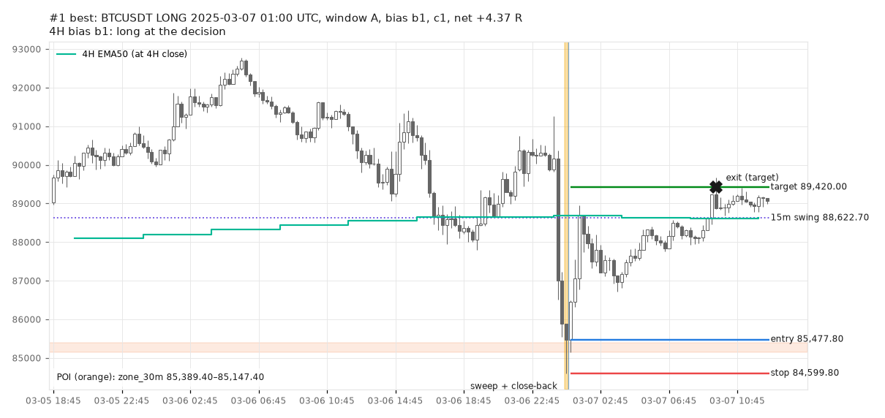
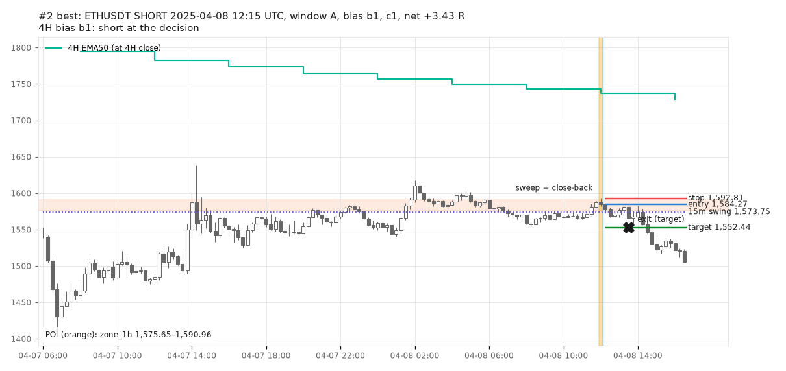
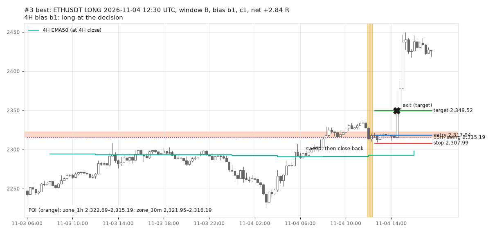
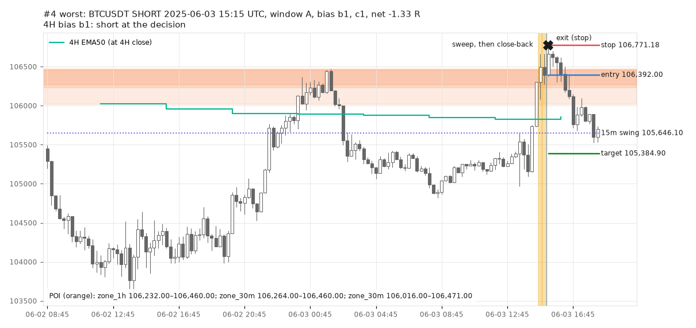
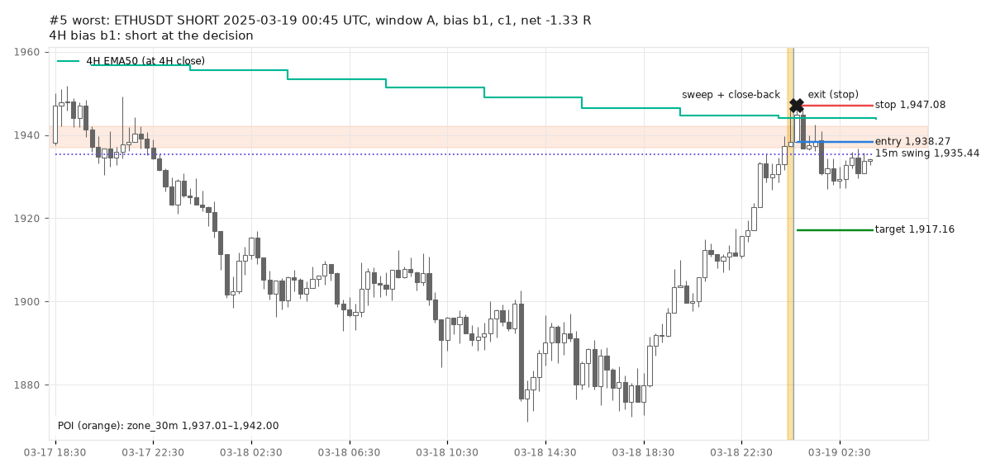
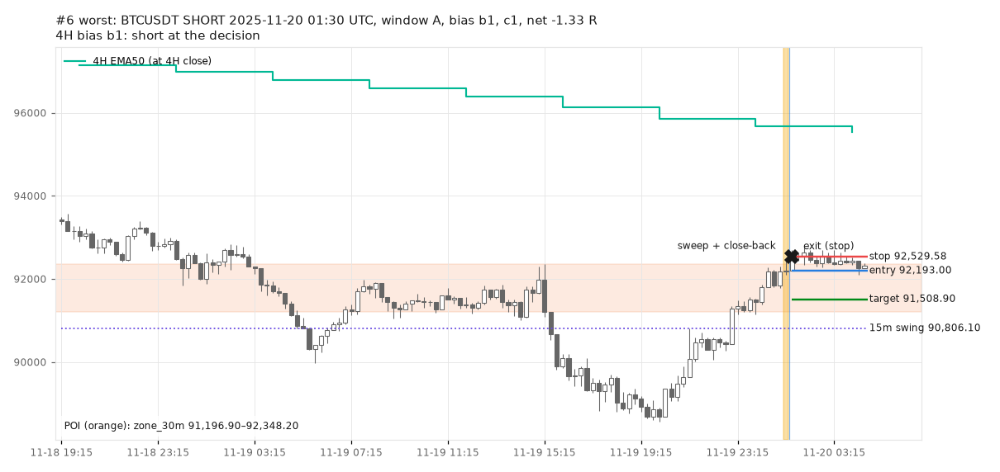
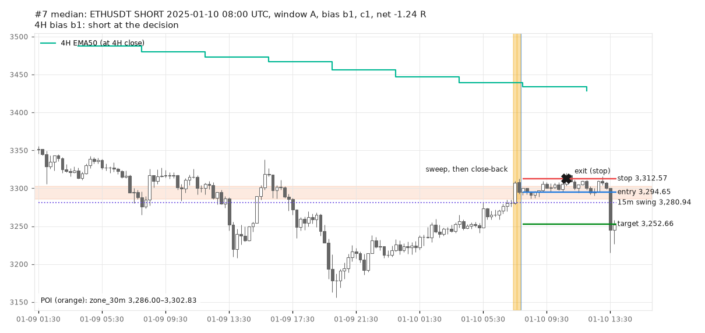
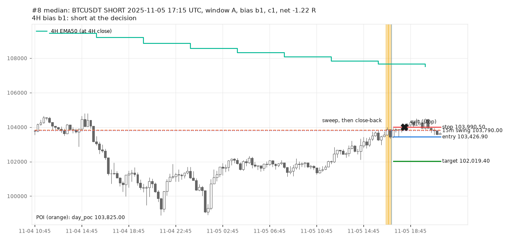
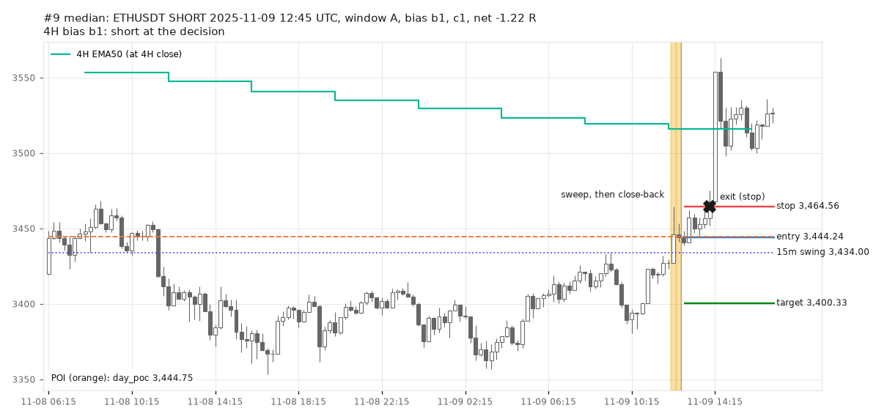
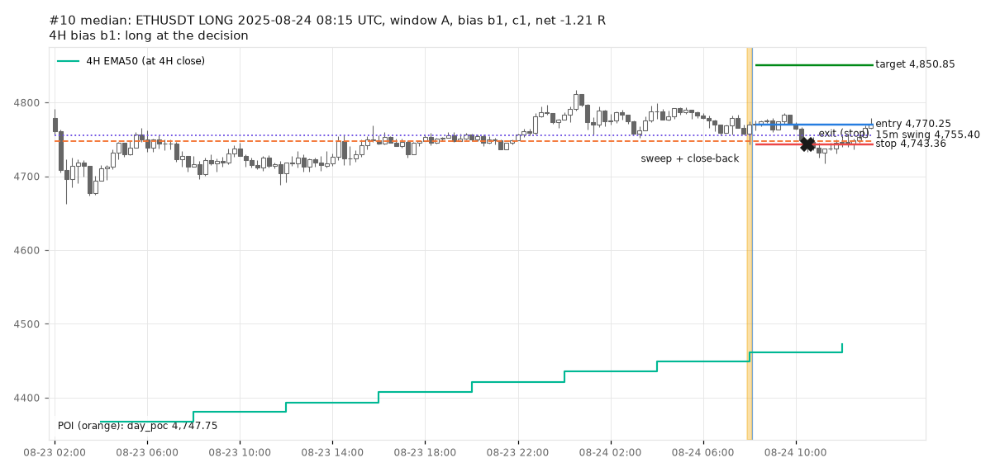

# ITERATION-4 example trades — run `20261127T182244Z-iter4-0610dfbc`

10 trades of the configuration `b1|c1|rr2` (most trades; none reached the minimum): the 3 best, the 3 worst and 4 around the median net R (default costs). Verdict: **KILLED** (no configuration with ≥ 60 trades on A+B).

Legend: grey candles = 15m (hollow = up); yellow bands = the sweep bar and the close-back (confirmation) bar; orange dashed line / band = the POI(s) (level / zone); violet dotted = the 15m swing that had to be swept; blue / red / green = entry / stop / target from the entry bar on; X = exit. Bias: b1 shows the 4H EMA50 as known at each 4H close; b2 marks the 4H fractal swings (▼ high, ▲ low) at their confirmation time (2 bars after the swing bar).

### 1. best — BTCUSDT LONG, entry 2025-03-07 01:00 UTC (window A)

- POI(s): `zone_30m:85389.4/85147.4`; 15m swing 88,622.70; sweep bar 03-07 00:45, close-back bar 03-07 00:45, sweep extreme 84,600.00
- entry 85,477.80, stop 84,599.80 (103 bps), target 89,420.00 (4.49 R); exit target at 89,420.00 03-07 09:32; gross +4.49 R, net +4.37 R (+448.6 bps)

### 2. best — ETHUSDT SHORT, entry 2025-04-08 12:15 UTC (window A)

- POI(s): `zone_1h:1575.65/1590.96`; 15m swing 1,573.75; sweep bar 04-08 12:00, close-back bar 04-08 12:00, sweep extreme 1,592.79
- entry 1,584.27, stop 1,592.81 (54 bps), target 1,552.44 (3.73 R); exit target at 1,552.44 04-08 13:37; gross +3.73 R, net +3.43 R (+184.7 bps)

### 3. best — ETHUSDT LONG, entry 2026-11-04 12:30 UTC (window B)

- POI(s): `zone_1h:2322.69/2315.19;zone_30m:2321.95/2316.19`; 15m swing 2,315.19; sweep bar 11-04 12:00, close-back bar 11-04 12:15, sweep extreme 2,310.11
- entry 2,317.94, stop 2,307.99 (43 bps), target 2,349.52 (3.17 R); exit target at 2,349.52 11-04 14:44; gross +3.17 R, net +2.84 R (+121.9 bps)

### 4. worst — BTCUSDT SHORT, entry 2025-06-03 15:15 UTC (window A)

- POI(s): `zone_1h:106232/106460;zone_30m:106264/106460;zone_30m:106016/106471`; 15m swing 105,646.10; sweep bar 06-03 14:45, close-back bar 06-03 15:00, sweep extreme 106,666.00
- entry 106,392.00, stop 106,771.18 (36 bps), target 105,384.90 (2.66 R); exit stop at 106,771.18 06-03 15:24; gross -1.00 R, net -1.33 R (-47.5 bps)

### 5. worst — ETHUSDT SHORT, entry 2025-03-19 00:45 UTC (window A)

- POI(s): `zone_30m:1937.01/1942`; 15m swing 1,935.44; sweep bar 03-19 00:30, close-back bar 03-19 00:30, sweep extreme 1,946.44
- entry 1,938.27, stop 1,947.08 (45 bps), target 1,917.16 (2.39 R); exit stop at 1,947.08 03-19 00:47; gross -1.00 R, net -1.33 R (-60.7 bps)

### 6. worst — BTCUSDT SHORT, entry 2025-11-20 01:30 UTC (window A)

- POI(s): `zone_30m:91196.9/92348.2`; 15m swing 90,806.10; sweep bar 11-20 01:15, close-back bar 11-20 01:15, sweep extreme 92,478.00
- entry 92,193.00, stop 92,529.58 (37 bps), target 91,508.90 (2.03 R); exit stop at 92,529.58 11-20 01:35; gross -1.00 R, net -1.33 R (-48.7 bps)

### 7. median — ETHUSDT SHORT, entry 2025-01-10 08:00 UTC (window A)

- POI(s): `zone_30m:3286/3302.83`; 15m swing 3,280.94; sweep bar 01-10 07:30, close-back bar 01-10 07:45, sweep extreme 3,312.55
- entry 3,294.65, stop 3,312.57 (54 bps), target 3,252.66 (2.34 R); exit stop at 3,312.57 01-10 10:56; gross -1.00 R, net -1.24 R (-67.5 bps)

### 8. median — BTCUSDT SHORT, entry 2025-11-05 17:15 UTC (window A)

- POI(s): `day_poc:103825/103825`; 15m swing 103,790.00; sweep bar 11-05 16:45, close-back bar 11-05 17:00, sweep extreme 103,990.30
- entry 103,426.90, stop 103,990.50 (54 bps), target 102,019.40 (2.50 R); exit stop at 103,990.50 11-05 18:17; gross -1.00 R, net -1.22 R (-66.5 bps)

### 9. median — ETHUSDT SHORT, entry 2025-11-09 12:45 UTC (window A)

- POI(s): `day_poc:3444.75/3444.75`; 15m swing 3,434.00; sweep bar 11-09 12:15, close-back bar 11-09 12:30, sweep extreme 3,464.54
- entry 3,444.24, stop 3,464.56 (59 bps), target 3,400.33 (2.16 R); exit stop at 3,464.56 11-09 14:07; gross -1.00 R, net -1.22 R (-71.9 bps)

### 10. median — ETHUSDT LONG, entry 2025-08-24 08:15 UTC (window A)

- POI(s): `day_poc:4747.75/4747.75`; 15m swing 4,755.40; sweep bar 08-24 08:00, close-back bar 08-24 08:00, sweep extreme 4,743.38
- entry 4,770.25, stop 4,743.36 (56 bps), target 4,850.85 (3.00 R); exit stop at 4,743.36 08-24 10:30; gross -1.00 R, net -1.21 R (-68.4 bps)

