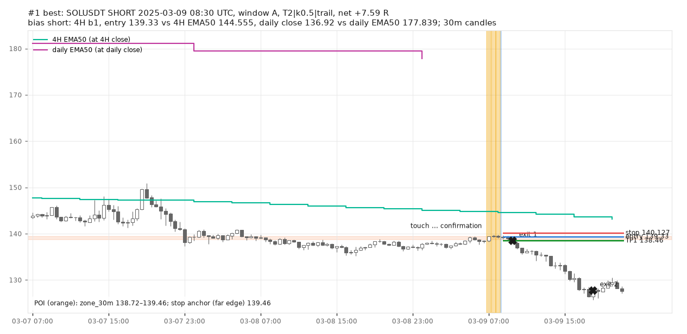
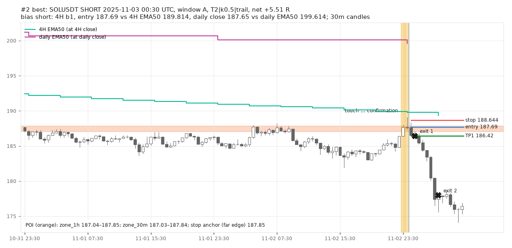
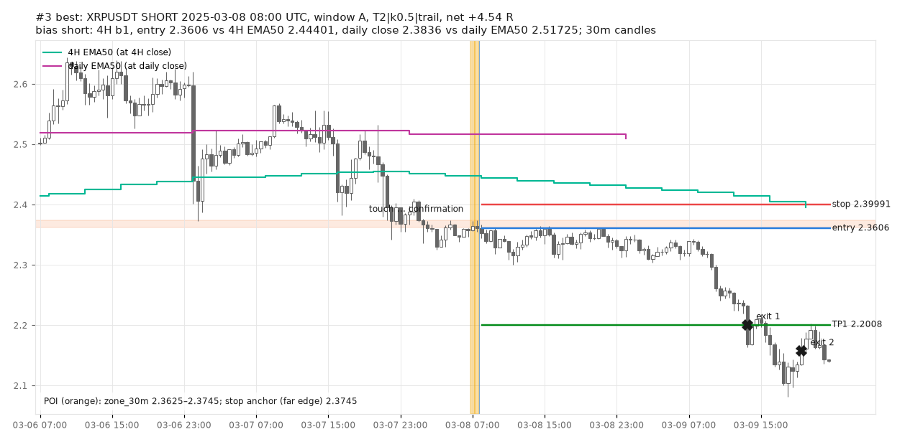
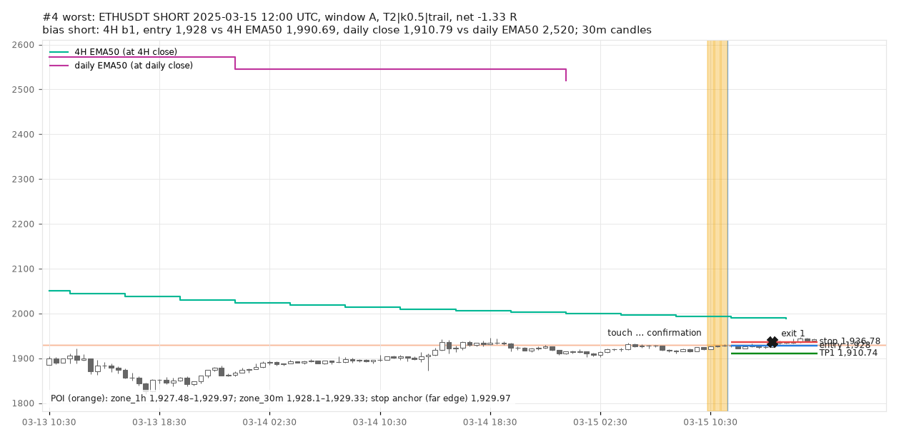
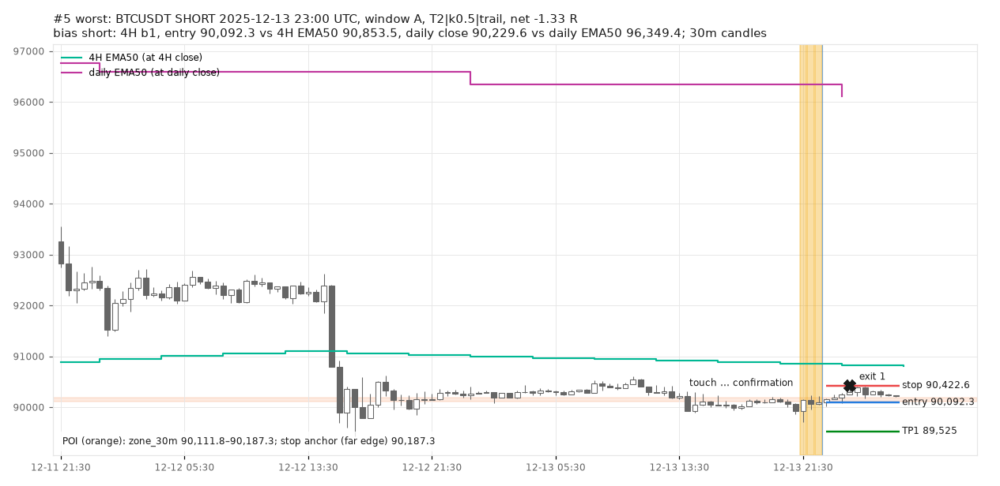
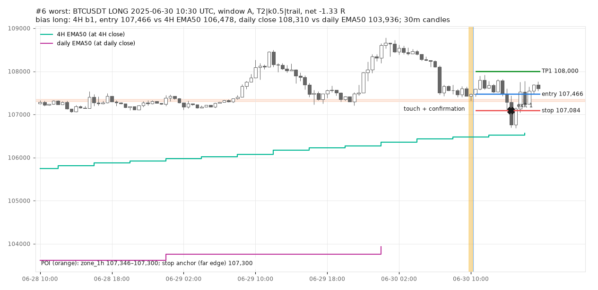
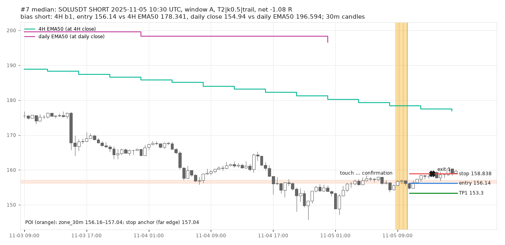
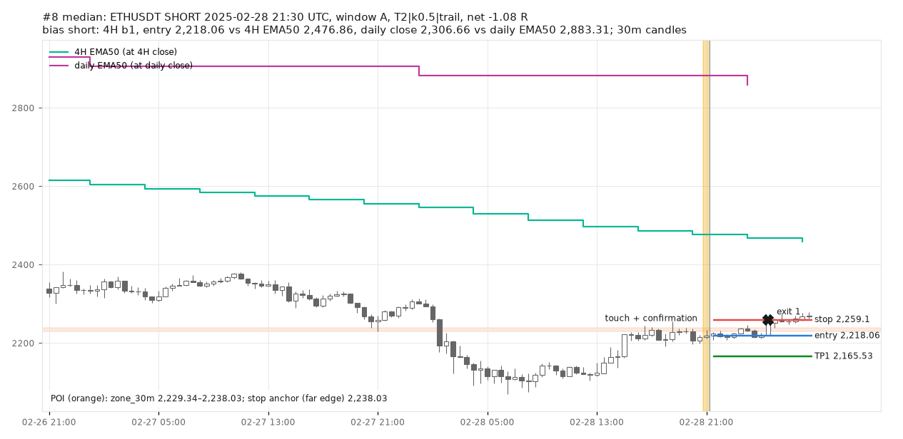
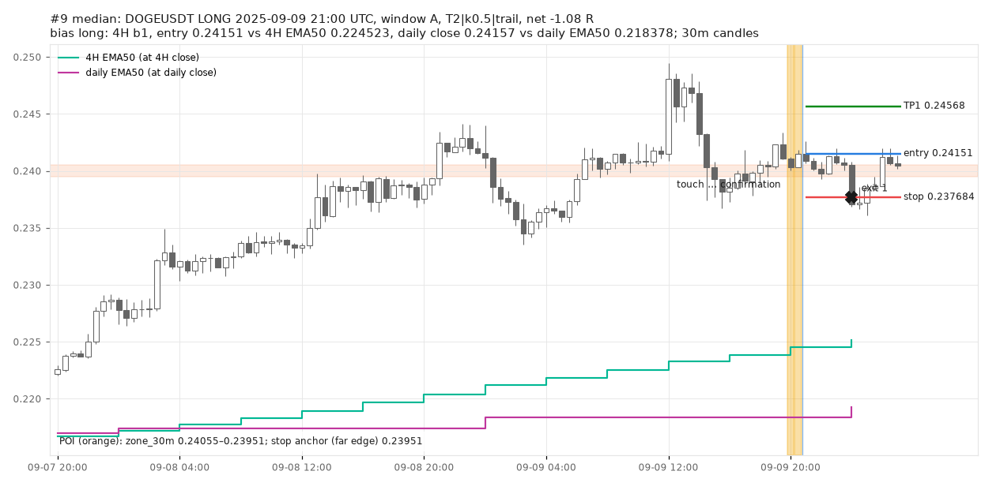
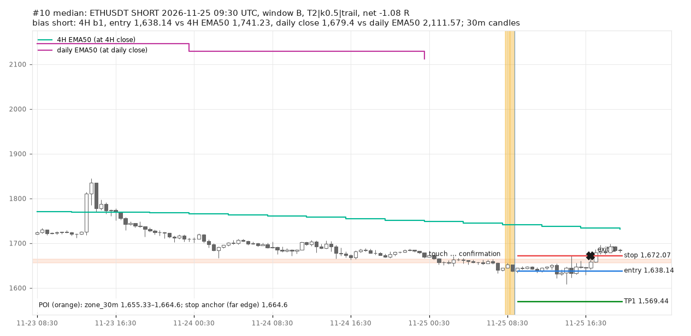

# ITERATION-5 example trades — run `20261127T194620Z-iter5-da431f34`

10 trades of the selected configuration `T2|k0.5|trail`: the 3 best, the 3 worst and 4 around the median net R (default costs). Verdict: **KILLED** (A+B net expectancy -0.079 R <= 0; positive symbols 2/6 (SOLUSDT, XRPUSDT), need ≥ 4).

Legend: grey candles = 15m (T1) or 30m (T2), hollow = up; yellow bands = the sweep and close-back bars (T1) or the touch … confirmation bars (T2); orange dashed line / band = the POI(s) (level / zone), the caption names them and the far edge that anchors the stop; violet dotted = the 15m swing that had to be swept (T1); blue / red / green = entry / stop / TP1 (dashed green = TP2 for `lvl`) from the entry on; X = the two half exits. Bias: teal = 4H EMA50 and magenta = daily EMA50, each as known at its bar close; the subtitle gives the values at the entry.

### 1. best — SOLUSDT SHORT, entry 2025-03-09 08:30 UTC (window A)

- POI(s): `zone_30m:138.72/139.46`; touch bar 03-09 07:00, confirmation bar 03-09 08:00, extreme 139.79
- bias: entry 139.33 vs 4H EMA50 144.555; daily close 136.92 vs daily EMA50 177.839
- stop 140.127 = far edge 139.46 ± 0.5 × ATR(1h) 1.334 (or the minimum distance): 57 bps; TP1 138.46 (1.09 R), TP2 137.865
- exit 1 138.46 at 03-09 09:47, exit 2 127.711 at 03-09 18:27 (tp1+trail); gross +7.83 R, net +7.59 R (+434.1 bps)

### 2. best — SOLUSDT SHORT, entry 2025-11-03 00:30 UTC (window A)

- POI(s): `zone_1h:187.04/187.85;zone_30m:187.03/187.84`; touch bar 11-02 23:30, confirmation bar 11-03 00:00, extreme 189.1
- bias: entry 187.69 vs 4H EMA50 189.814; daily close 187.65 vs daily EMA50 199.614
- stop 188.644 = far edge 187.85 ± 0.5 × ATR(1h) 1.588 (or the minimum distance): 51 bps; TP1 186.42 (1.33 R), TP2 186.39
- exit 1 186.42 at 11-03 01:00, exit 2 177.962 at 11-03 04:28 (tp1+trail); gross +5.76 R, net +5.51 R (+279.9 bps)

### 3. best — XRPUSDT SHORT, entry 2025-03-08 08:00 UTC (window A)

- POI(s): `zone_30m:2.3625/2.3745`; touch bar 03-08 07:00, confirmation bar 03-08 07:30, extreme 2.3735
- bias: entry 2.3606 vs 4H EMA50 2.44401; daily close 2.3836 vs daily EMA50 2.51725
- stop 2.39991 = far edge 2.3745 ± 0.5 × ATR(1h) 0.05081 (or the minimum distance): 167 bps; TP1 2.2008 (4.07 R), TP2 2.1905
- exit 1 2.2008 at 03-09 13:50, exit 2 2.15762 at 03-09 19:32 (tp1+trail); gross +4.61 R, net +4.54 R (+755.4 bps)

### 4. worst — ETHUSDT SHORT, entry 2025-03-15 12:00 UTC (window A)

- POI(s): `zone_1h:1927.48/1929.97;zone_30m:1928.1/1929.33`; touch bar 03-15 10:30, confirmation bar 03-15 11:30, extreme 1,930.86
- bias: entry 1,928 vs 4H EMA50 1,990.69; daily close 1,910.79 vs daily EMA50 2,520
- stop 1,936.78 = far edge 1,929.97 ± 0.5 × ATR(1h) 11.99 (or the minimum distance): 46 bps; TP1 1,910.74 (1.96 R), TP2 1,893.75
- exit 1 1,936.78 at 03-15 15:22, exit 2 1,936.78 at 03-15 15:22 (stop); gross -1.00 R, net -1.33 R (-60.8 bps)

### 5. worst — BTCUSDT SHORT, entry 2025-12-13 23:00 UTC (window A)

- POI(s): `zone_30m:90111.8/90187.3`; touch bar 12-13 21:30, confirmation bar 12-13 22:30, extreme 90,227.4
- bias: entry 90,092.3 vs 4H EMA50 90,853.5; daily close 90,229.6 vs daily EMA50 96,349.4
- stop 90,422.6 = far edge 90,187.3 ± 0.5 × ATR(1h) 240.9 (or the minimum distance): 37 bps; TP1 89,525 (1.72 R), TP2 88,800
- exit 1 90,422.6 at 12-14 00:35, exit 2 90,422.6 at 12-14 00:35 (stop); gross -1.00 R, net -1.33 R (-48.9 bps)

### 6. worst — BTCUSDT LONG, entry 2025-06-30 10:30 UTC (window A)

- POI(s): `zone_1h:107346/107300`; touch bar 06-30 10:00, confirmation bar 06-30 10:00, extreme 107,320
- bias: entry 107,466 vs 4H EMA50 106,478; daily close 108,310 vs daily EMA50 103,936
- stop 107,084 = far edge 107,300 ± 0.5 × ATR(1h) 373.4 (or the minimum distance): 36 bps; TP1 108,000 (1.40 R), TP2 108,100
- exit 1 107,084 at 06-30 14:50, exit 2 107,084 at 06-30 14:50 (stop); gross -1.00 R, net -1.33 R (-47.4 bps)

### 7. median — SOLUSDT SHORT, entry 2025-11-05 10:30 UTC (window A)

- POI(s): `zone_30m:156.16/157.04`; touch bar 11-05 09:00, confirmation bar 11-05 10:00, extreme 157.25
- bias: entry 156.14 vs 4H EMA50 178.341; daily close 154.94 vs daily EMA50 196.594
- stop 158.838 = far edge 157.04 ± 0.5 × ATR(1h) 3.596 (or the minimum distance): 173 bps; TP1 153.3 (1.05 R), TP2 152.59
- exit 1 158.838 at 11-05 13:41, exit 2 158.838 at 11-05 13:41 (stop); gross -1.00 R, net -1.08 R (-186.7 bps)

### 8. median — ETHUSDT SHORT, entry 2025-02-28 21:30 UTC (window A)

- POI(s): `zone_30m:2229.34/2238.03`; touch bar 02-28 21:00, confirmation bar 02-28 21:00, extreme 2,233.8
- bias: entry 2,218.06 vs 4H EMA50 2,476.86; daily close 2,306.66 vs daily EMA50 2,883.31
- stop 2,259.1 = far edge 2,238.03 ± 0.5 × ATR(1h) 42.13 (or the minimum distance): 185 bps; TP1 2,165.53 (1.28 R), TP2 2,123.57
- exit 1 2,259.1 at 03-01 01:56, exit 2 2,259.1 at 03-01 01:56 (stop); gross -1.00 R, net -1.08 R (-199.6 bps)

### 9. median — DOGEUSDT LONG, entry 2025-09-09 21:00 UTC (window A)

- POI(s): `zone_30m:0.24055/0.23951`; touch bar 09-09 20:00, confirmation bar 09-09 20:30, extreme 0.24002
- bias: entry 0.24151 vs 4H EMA50 0.224523; daily close 0.24157 vs daily EMA50 0.218378
- stop 0.237684 = far edge 0.23951 ± 0.5 × ATR(1h) 0.003652 (or the minimum distance): 158 bps; TP1 0.24568 (1.09 R), TP2 0.24686
- exit 1 0.237684 at 09-10 00:27, exit 2 0.237684 at 09-10 00:27 (stop); gross -1.00 R, net -1.08 R (-170.8 bps)

### 10. median — ETHUSDT SHORT, entry 2026-11-25 09:30 UTC (window B)

- POI(s): `zone_30m:1655.33/1664.6`; touch bar 11-25 08:30, confirmation bar 11-25 09:00, extreme 1,656.37
- bias: entry 1,638.14 vs 4H EMA50 1,741.23; daily close 1,679.4 vs daily EMA50 2,111.57
- stop 1,672.07 = far edge 1,664.6 ± 0.5 × ATR(1h) 14.95 (or the minimum distance): 207 bps; TP1 1,569.44 (2.02 R), TP2 1,561.45
- exit 1 1,672.07 at 11-25 17:18, exit 2 1,672.07 at 11-25 17:18 (stop); gross -1.00 R, net -1.08 R (-223.4 bps)

