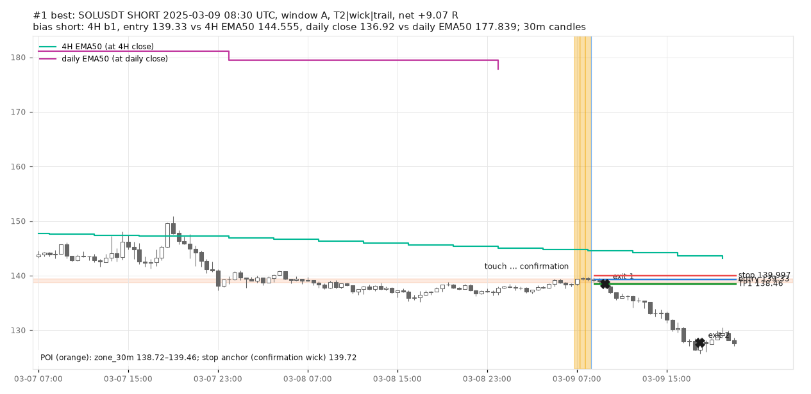
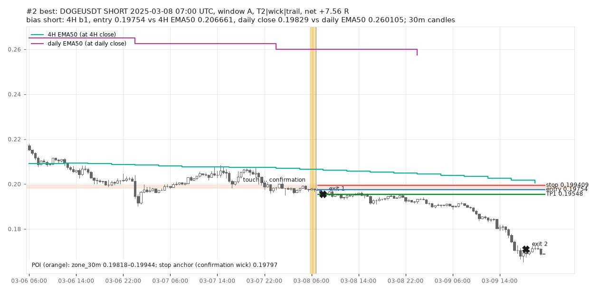
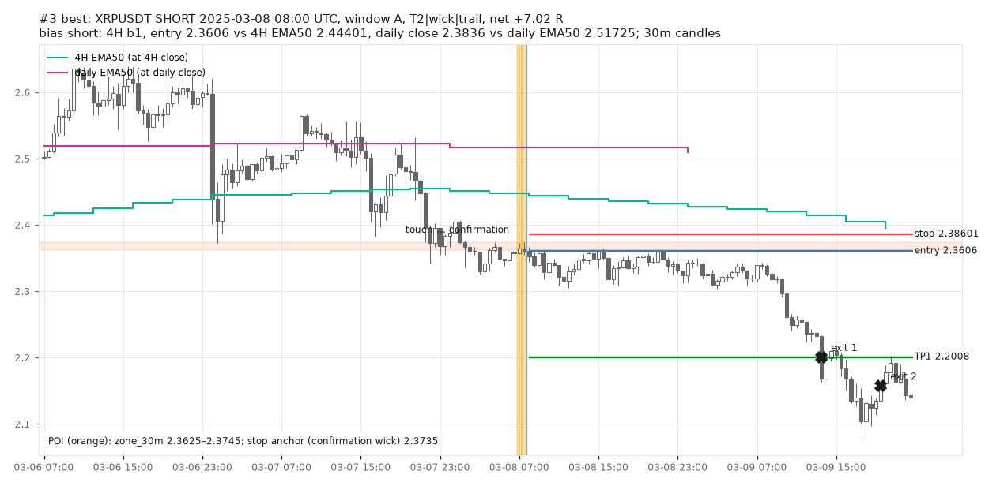
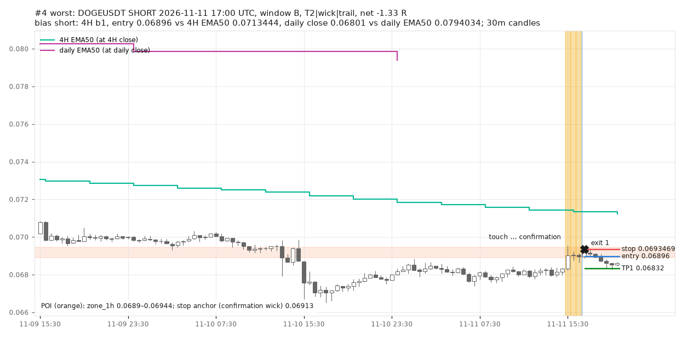
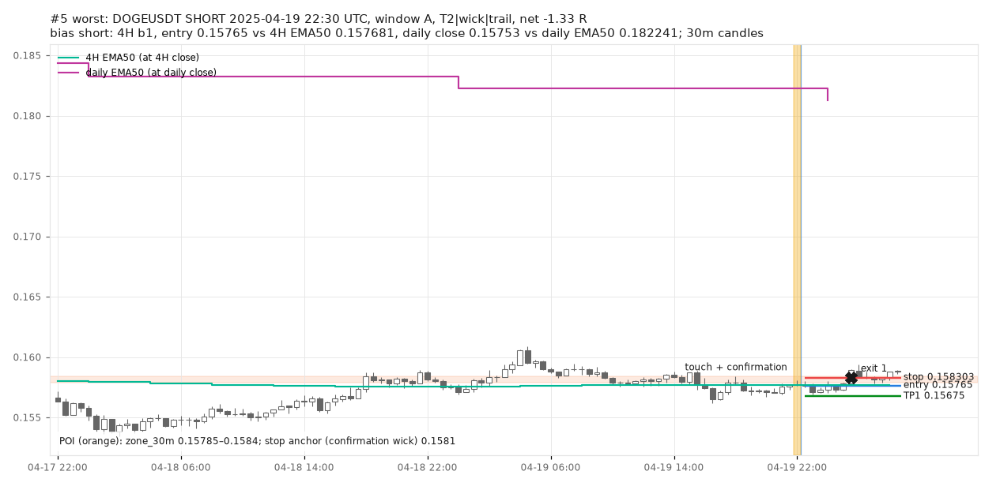
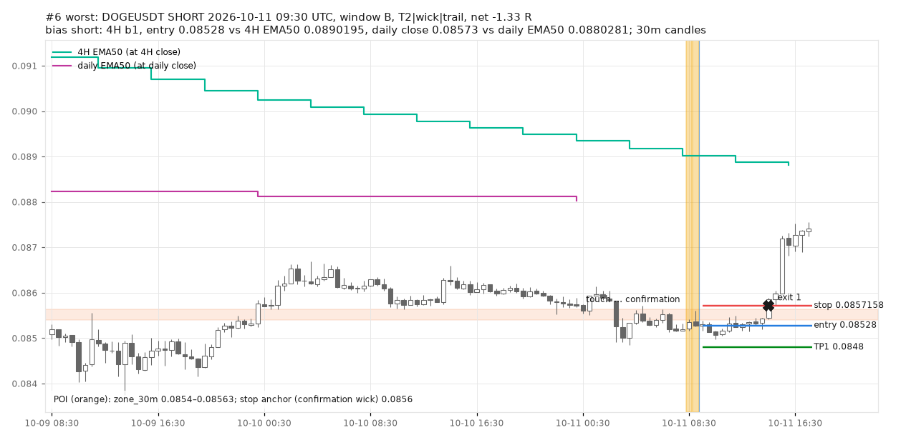
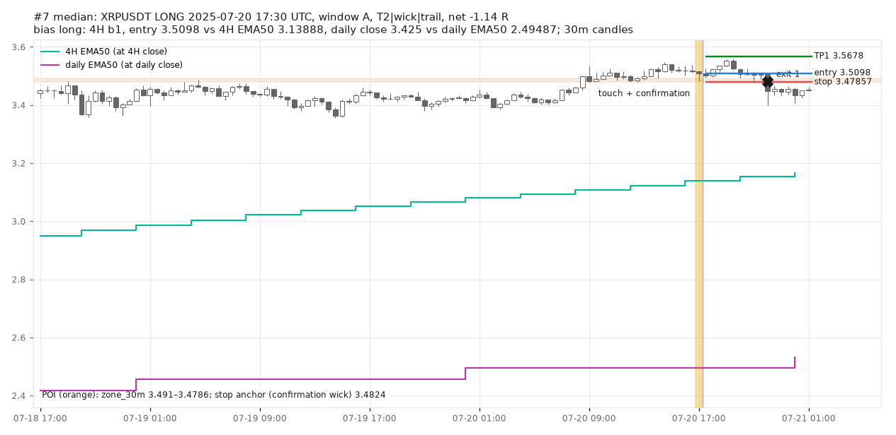
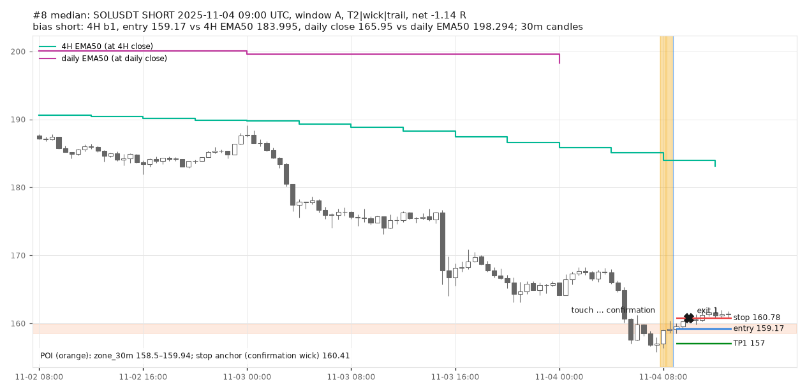
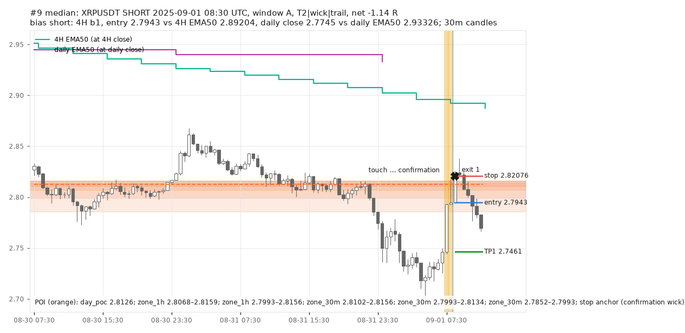
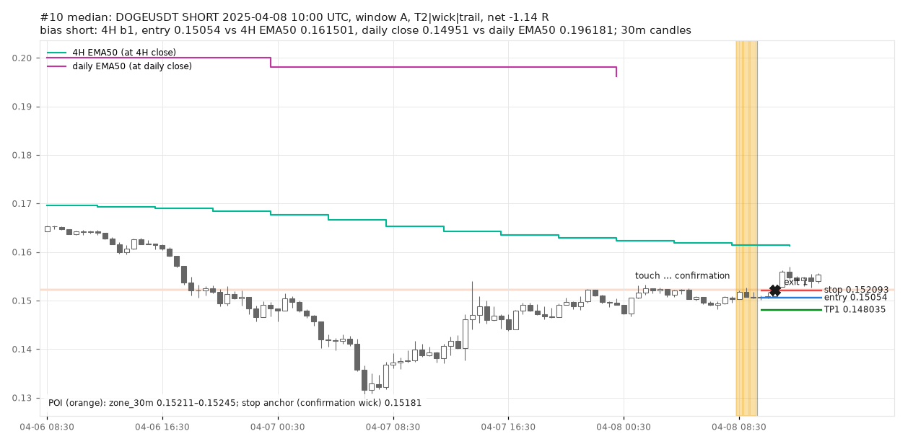

# Paper variant c `T2|wick|trail` example trades — run `20261127T211931Z-paperref-a086f3e1`

10 trades (3 best, 3 worst, 4 around the median net R, default costs) to check the wick stop visually. Same chart legend as `TRADES-ITER5.md`.

### 1. best — SOLUSDT SHORT, entry 2025-03-09 08:30 UTC (window A)

- POI(s): `zone_30m:138.72/139.46`; touch bar 03-09 07:00, confirmation bar 03-09 08:00, extreme 139.79
- bias: entry 139.33 vs 4H EMA50 144.555; daily close 136.92 vs daily EMA50 177.839
- stop 139.997 = confirmation-candle wick 139.72 ± 0.1 × ATR(1h) 1.334 (or the minimum distance): 48 bps; TP1 138.46 (1.30 R), TP2 137.865
- exit 1 138.46 at 03-09 09:47, exit 2 127.711 at 03-09 18:27 (tp1+trail); gross +9.36 R, net +9.07 R (+434.1 bps)

### 2. best — DOGEUSDT SHORT, entry 2025-03-08 07:00 UTC (window A)

- POI(s): `zone_30m:0.19818/0.19944`; touch bar 03-08 06:00, confirmation bar 03-08 06:30, extreme 0.19845
- bias: entry 0.19754 vs 4H EMA50 0.206661; daily close 0.19829 vs daily EMA50 0.260105
- stop 0.199409 = confirmation-candle wick 0.19797 ± 0.1 × ATR(1h) 0.003738 (or the minimum distance): 95 bps; TP1 0.19548 (1.10 R), TP2 0.1945
- exit 1 0.19548 at 03-08 08:19, exit 2 0.170847 at 03-09 18:31 (tp1+trail); gross +7.69 R, net +7.56 R (+715.1 bps)

### 3. best — XRPUSDT SHORT, entry 2025-03-08 08:00 UTC (window A)

- POI(s): `zone_30m:2.3625/2.3745`; touch bar 03-08 07:00, confirmation bar 03-08 07:30, extreme 2.3735
- bias: entry 2.3606 vs 4H EMA50 2.44401; daily close 2.3836 vs daily EMA50 2.51725
- stop 2.38601 = confirmation-candle wick 2.3735 ± 0.1 × ATR(1h) 0.05081 (or the minimum distance): 108 bps; TP1 2.2008 (6.29 R), TP2 2.1905
- exit 1 2.2008 at 03-09 13:50, exit 2 2.15762 at 03-09 19:32 (tp1+trail); gross +7.14 R, net +7.02 R (+755.4 bps)

### 4. worst — DOGEUSDT SHORT, entry 2026-11-11 17:00 UTC (window B)

- POI(s): `zone_1h:0.0689/0.06944`; touch bar 11-11 15:30, confirmation bar 11-11 16:30, extreme 0.06953
- bias: entry 0.06896 vs 4H EMA50 0.0713444; daily close 0.06801 vs daily EMA50 0.0794034
- stop 0.0693469 = confirmation-candle wick 0.06913 ± 0.1 × ATR(1h) 0.0006186 (or the minimum distance): 56 bps; TP1 0.06832 (1.65 R), TP2 0.06827
- exit 1 0.0693469 at 11-11 17:18, exit 2 0.0693469 at 11-11 17:18 (stop); gross -1.00 R, net -1.33 R (-74.8 bps)

### 5. worst — DOGEUSDT SHORT, entry 2025-04-19 22:30 UTC (window A)

- POI(s): `zone_30m:0.15785/0.1584`; touch bar 04-19 22:00, confirmation bar 04-19 22:00, extreme 0.1581
- bias: entry 0.15765 vs 4H EMA50 0.157681; daily close 0.15753 vs daily EMA50 0.182241
- stop 0.158303 = confirmation-candle wick 0.1581 ± 0.1 × ATR(1h) 0.001041 (or the minimum distance): 41 bps; TP1 0.15675 (1.38 R), TP2 0.154875
- exit 1 0.158303 at 04-20 01:39, exit 2 0.158303 at 04-20 01:39 (stop); gross -1.00 R, net -1.33 R (-55.2 bps)

### 6. worst — DOGEUSDT SHORT, entry 2026-10-11 09:30 UTC (window B)

- POI(s): `zone_30m:0.0854/0.08563`; touch bar 10-11 08:30, confirmation bar 10-11 09:00, extreme 0.0856
- bias: entry 0.08528 vs 4H EMA50 0.0890195; daily close 0.08573 vs daily EMA50 0.0880281
- stop 0.0857158 = confirmation-candle wick 0.0856 ± 0.1 × ATR(1h) 0.0004071 (or the minimum distance): 51 bps; TP1 0.0848 (1.10 R), TP2 0.0846
- exit 1 0.0857158 at 10-11 14:35, exit 2 0.0857158 at 10-11 14:35 (stop); gross -1.00 R, net -1.33 R (-68.2 bps)

### 7. median — XRPUSDT LONG, entry 2025-07-20 17:30 UTC (window A)

- POI(s): `zone_30m:3.491/3.4786`; touch bar 07-20 17:00, confirmation bar 07-20 17:00, extreme 3.4824
- bias: entry 3.5098 vs 4H EMA50 3.13888; daily close 3.425 vs daily EMA50 2.49487
- stop 3.47857 = confirmation-candle wick 3.4824 ± 0.1 × ATR(1h) 0.03835 (or the minimum distance): 89 bps; TP1 3.5678 (1.86 R), TP2 3.5929
- exit 1 3.47857 at 07-20 22:07, exit 2 3.47857 at 07-20 22:07 (stop); gross -1.00 R, net -1.14 R (-101.2 bps)

### 8. median — SOLUSDT SHORT, entry 2025-11-04 09:00 UTC (window A)

- POI(s): `zone_30m:158.5/159.94`; touch bar 11-04 08:00, confirmation bar 11-04 08:30, extreme 160.41
- bias: entry 159.17 vs 4H EMA50 183.995; daily close 165.95 vs daily EMA50 198.294
- stop 160.78 = confirmation-candle wick 160.41 ± 0.1 × ATR(1h) 3.219 (or the minimum distance): 101 bps; TP1 157 (1.35 R), no TP2
- exit 1 160.78 at 11-04 10:16, exit 2 160.78 at 11-04 10:16 (stop); gross -1.00 R, net -1.14 R (-114.9 bps)

### 9. median — XRPUSDT SHORT, entry 2025-09-01 08:30 UTC (window A)

- POI(s): `day_poc:2.8126/2.8126;zone_1h:2.8068/2.8159;zone_1h:2.7993/2.8156;zone_30m:2.8102/2.8156;zone_30m:2.7993/2.8134;zone_30m:2.7852/2.7993`; touch bar 09-01 07:30, confirmation bar 09-01 08:00, extreme 2.8179
- bias: entry 2.7943 vs 4H EMA50 2.89204; daily close 2.7745 vs daily EMA50 2.93326
- stop 2.82076 = confirmation-candle wick 2.8179 ± 0.1 × ATR(1h) 0.02865 (or the minimum distance): 95 bps; TP1 2.7461 (1.82 R), TP2 2.7357
- exit 1 2.82076 at 09-01 08:59, exit 2 2.82076 at 09-01 08:59 (stop); gross -1.00 R, net -1.14 R (-107.6 bps)

### 10. median — DOGEUSDT SHORT, entry 2025-04-08 10:00 UTC (window A)

- POI(s): `zone_30m:0.15211/0.15245`; touch bar 04-08 08:30, confirmation bar 04-08 09:30, extreme 0.1527
- bias: entry 0.15054 vs 4H EMA50 0.161501; daily close 0.14951 vs daily EMA50 0.196181
- stop 0.152093 = confirmation-candle wick 0.15181 ± 0.1 × ATR(1h) 0.002828 (or the minimum distance): 103 bps; TP1 0.148035 (1.61 R), TP2 0.14677
- exit 1 0.152093 at 04-08 11:18, exit 2 0.152093 at 04-08 11:18 (stop); gross -1.00 R, net -1.14 R (-117.2 bps)

